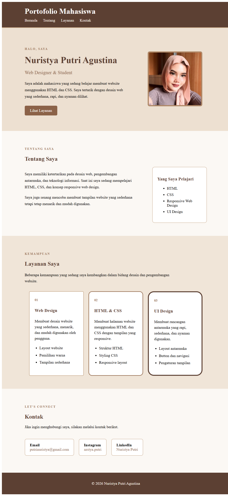

# Website Portofolio Mahasiswa

## 1. Deskripsi Proyek

Proyek ini merupakan website portofolio mahasiswa sederhana yang dibuat menggunakan **HTML** dan **CSS**. Website menampilkan profil singkat, informasi tentang diri, kemampuan yang sedang dipelajari, layanan atau keterampilan, serta informasi kontak.

Desain menggunakan nuansa warna cokelat dan krem agar tampilan terlihat sederhana, rapi, dan nyaman dibaca. CSS juga mengatur tata letak responsif agar konten lebih nyaman dilihat pada layar kecil.

## 2. Tujuan Proyek

- Membuat halaman profil mahasiswa menggunakan HTML dan CSS.
- Memisahkan struktur halaman dan aturan desain ke dalam file yang berbeda.
- Menerapkan box model CSS, seperti `padding`, `margin`, dan `border`.
- Menggunakan class CSS yang dapat digunakan kembali.
- Menerapkan responsive web design menggunakan media query pada breakpoint 768 px.

## 3. Struktur File

Struktur file yang digunakan:

```text
project-portofolio/
├── tugas.html
├── tugas.css
└── putri.jpeg
```

**Catatan:** file yang dikumpulkan saat ini bernama `tugas.html` dan `tugas.css`. Pada instruksi tugas, nama yang diminta adalah `index.html` dan `style.css`. Jika dosen mengharuskan nama tersebut, ubah nama file dan sesuaikan baris pemanggilan CSS di HTML. File `putri.jpeg` juga perlu berada di folder yang sama agar foto profil dapat ditampilkan.

## 4. Penjelasan File HTML (`tugas.html`)

HTML berfungsi sebagai struktur dan isi website. Dokumen menggunakan `lang="id"` untuk menandai bahasa Indonesia, `meta charset="UTF-8"` untuk mendukung karakter teks, serta `meta viewport` agar ukuran halaman mengikuti perangkat yang digunakan.

HTML memanggil stylesheet eksternal dengan:

```html
<link rel="stylesheet" href="tugas.css">
```

Bagian-bagian halaman:

### a. Header dan navigasi

Header menampilkan judul **Portofolio Mahasiswa**. Navigasi memiliki tautan Beranda, Tentang, Layanan, dan Kontak. Setiap tautan mengarah ke bagian halaman melalui atribut `href` seperti `#hero` dan `#tentang`.

### b. Hero atau bagian pembuka

Bagian `#hero` memperkenalkan pemilik portofolio, yaitu Nuristya Putri Agustina, dengan keterangan **Web Designer & Student**. Bagian ini memuat deskripsi singkat, tombol “Lihat Layanan”, dan foto profil dari `putri.jpeg`.

Tombol “Lihat Layanan” mengarah ke bagian layanan melalui `href="#layanan"`.

### c. Tentang saya

Bagian `#tentang` menjelaskan minat pada desain web, pengembangan antarmuka, dan teknologi informasi. Kotak “Yang Saya Pelajari” berisi HTML, CSS, Responsive Web Design, dan UI Design.

### d. Layanan atau kemampuan

Bagian `#layanan` berisi tiga kartu kemampuan:

1. **Web Design** — membahas layout website, pemilihan warna, dan tampilan sederhana.
2. **HTML & CSS** — membahas struktur HTML, styling CSS, dan responsive layout.
3. **UI Design** — membahas layout antarmuka, tombol, navigasi, dan pengaturan tampilan.

Ketiga kartu menggunakan class dasar `layanan-card` dan class tambahan `card-satu`, `card-dua`, serta `card-tiga`.

### e. Kontak

Bagian `#kontak` menampilkan informasi email, Instagram, dan LinkedIn. Tautan email menggunakan format `mailto:`, sedangkan tautan media sosial membuka alamat eksternal.

### f. Footer

Footer menampilkan informasi hak cipta tahun 2026 dan nama pemilik portofolio.

## 5. Penjelasan File CSS (`tugas.css`)

CSS berfungsi mengatur warna, ukuran, jarak, tata letak, dan responsivitas website.

### a. Dasar halaman

Selector `body` mengatur jenis huruf Arial, menghapus margin bawaan browser, serta menentukan warna latar krem dan warna teks cokelat.

Class `.container` membatasi lebar konten hingga 1100 px dan memusatkannya dengan `margin: auto`.

### b. Header dan navigasi

Selector `header`, `header h1`, `nav`, dan `nav a` mengatur warna latar cokelat, jarak, warna teks, serta tampilan tautan navigasi. Efek `:hover` mengubah warna tautan ketika pointer diarahkan ke atasnya.

### c. Hero dan foto profil

Bagian `#hero` memiliki latar krem kecokelatan dan ruang vertikal. `.hero-content` memakai Flexbox untuk menempatkan teks dan foto berdampingan. `.hero-image img` mengatur ukuran foto, `object-fit: cover`, sudut membulat melalui `border-radius`, dan bingkai melalui `border`.

### d. Tombol

Class `.button` mengatur tampilan tautan agar menyerupai tombol, termasuk warna, padding, margin, dan sudut membulat. `.button:hover` mengubah warna latar ketika pointer diarahkan ke tombol.

### e. Bagian tentang saya

`.about-content` menggunakan Flexbox untuk menempatkan teks dan kotak informasi berdampingan. `.about-text` mengatur lebar dan jarak antarbaris. `.about-box` menggunakan latar putih, padding, border, `border-radius`, dan `box-sizing: border-box`.

### f. Kartu layanan

`.layanan-wrapper` mengatur tiga kartu dalam satu baris menggunakan Flexbox dan `gap`. `.layanan-card` mengatur lebar, padding, latar, dan jarak teks.

Class `.card-satu`, `.card-dua`, dan `.card-tiga` memberi variasi ketebalan border dan radius pada masing-masing kartu. Efek hover pada `.layanan-card:hover` mengangkat kartu sedikit dan menambahkan bayangan.

### g. Kontak dan footer

`.contact-box` menata kotak-kotak kontak menggunakan Flexbox. Selector `.contact-box p` memberi latar putih, padding, border, dan sudut membulat. Footer menggunakan latar cokelat, teks terang, perataan tengah, dan padding.

### h. Responsive design

Media query berikut aktif ketika lebar layar maksimal 768 px:

```css
@media (max-width: 768px) {
    /* aturan tampilan layar kecil */
}
```

Di dalamnya, lebar container menjadi 90%; bagian hero berubah menjadi kolom dan rata tengah; bagian tentang saya berubah menjadi kolom; kartu layanan ditampilkan vertikal dengan lebar 100%; kotak kontak ditampilkan vertikal; dan tautan navigasi diberi jarak yang sesuai.

## 6. Penerapan Box Model dan Class Reusable

### Box model

Box model terlihat pada beberapa elemen berikut:

- `padding` memberi ruang di dalam elemen, misalnya pada header, tombol, kartu, dan kotak kontak.
- `margin` memberi jarak di luar elemen, misalnya pada container, tombol, dan wrapper kartu.
- `border` membuat garis tepi pada foto, kotak informasi, dan kartu layanan.
- `box-sizing: border-box` membuat ukuran elemen mencakup padding dan border.

### Class reusable

Contoh class yang digunakan kembali:

- `.container` digunakan pada beberapa bagian halaman agar lebar konten konsisten.
- `.section` digunakan untuk memberi jarak vertikal pada beberapa bagian.
- `.section-label` digunakan untuk gaya label bagian.
- `.layanan-card` digunakan sebagai gaya dasar bagi ketiga kartu layanan.
- `.button` dapat digunakan pada tautan lain yang ingin ditampilkan sebagai tombol.

## 7. Cara Menjalankan Website

1. Simpan `tugas.html`, `tugas.css`, dan `putri.jpeg` di folder yang sama.
2. Pastikan nama file pada atribut `href` dan `src` sesuai dengan nama file sebenarnya.
3. Buka `tugas.html` menggunakan browser, atau gunakan ekstensi Live Server di Visual Studio Code.
4. Uji navigasi Beranda, Tentang, Layanan, dan Kontak.
5. Ubah ukuran browser atau gunakan mode perangkat pada Developer Tools untuk memeriksa tampilan mobile.

## 8. Screenshot

Berikut adalah hasil tampilan halaman portofolio pada perangkat desktop dan mobile

# DESKTOP


# MOBILE


## 9. Ringkasan

Website ini adalah portofolio mahasiswa dengan bagian header, hero, tentang saya, tiga kartu kemampuan, kontak, dan footer. HTML mengatur struktur serta konten, sedangkan CSS mengatur tema warna, tata letak Flexbox, box model, efek hover, dan tampilan responsif melalui media query 768 px.

Sebelum dikumpulkan, pastikan nama file sesuai instruksi, foto `putri.jpeg` tersedia, dan tampilan telah diperiksa pada desktop serta mobile.
